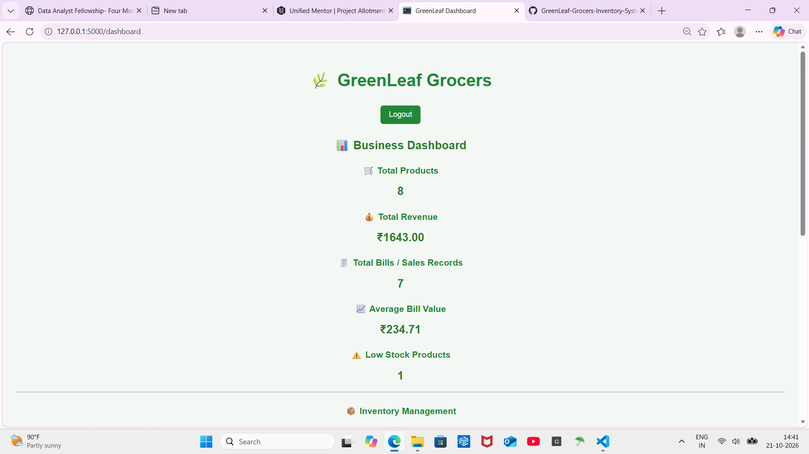
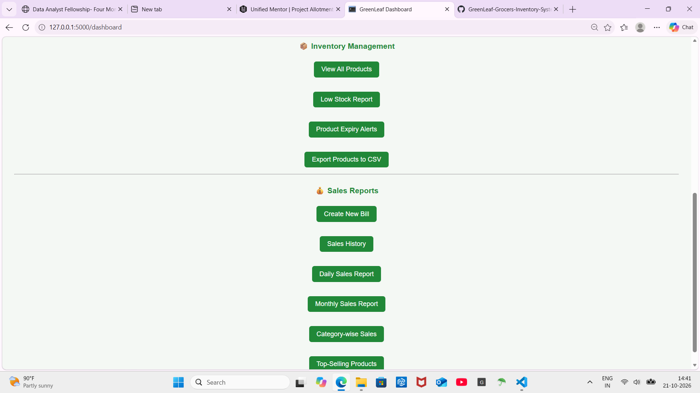

# 🛒 GreenLeaf Grocers — Inventory & Sales Management System

A Python Flask-based web application for managing grocery store inventory, billing, sales transactions, and business analytics. The system supports admin and cashier roles, automated stock updates, and sales reporting through an interactive dashboard.

## 📌 Project Overview

GreenLeaf Grocers helps grocery store owners manage daily operations efficiently through a web-based interface backed by an SQLite database.

## ✨ Key Features

* 🔐 **Authentication & Roles** — Login system with admin and cashier access.
* 📦 **Inventory Management** — Add, edit, delete, search, and filter products.
* 🧾 **Billing System** — Generate bills and calculate discounts.
* 🔄 **Automatic Stock Updates** — Update inventory after successful sales.
* ⚠️ **Stock & Expiry Alerts** — Identify low-stock and expiring products.
* 📊 **Sales Analytics** — View sales summaries, reports, and interactive charts.
* 📅 **Sales History** — Review bill summaries and individual sale details.
* 📥 **CSV Import & Export** — Support product data management through CSV files.
* 🖨️ **Bill Printing & Downloading** — Print or download bills.

## 🛠️ Technologies Used

| Technology | Purpose                    |
| ---------- | -------------------------- |
| Python     | Application logic          |
| Flask      | Web application framework  |
| SQLite     | Database management        |
| HTML & CSS | User interface and styling |
| Plotly     | Interactive charts         |
| CSV        | Data import and export     |

## 📂 Project Structure

```text
GreenLeaf-Grocers-Inventory-System/
│
├── web_app.py
├── app.py
├── database.py
├── requirements.txt
├── README.md
├── .gitignore
│
└── static/
    └── style.css
```

*Note: The SQLite database is created locally when the application is initialized and is not included in the repository.*

## ⚙️ Installation

**Prerequisites:** Python 3.13 or another compatible Python 3 version.

1. Clone the repository:

   ```bash
   git clone https://github.com/kamuniudayasree-prog/GreenLeaf-Grocers-Inventory-System.git
   ```

2. Open the project directory:

   ```bash
   cd GreenLeaf-Grocers-Inventory-System
   ```

3. Install the required packages:

   ```bash
   pip install -r requirements.txt
   ```

## ▶️ Run the Application

Start the Flask application:

```bash
python web_app.py
```

Open the local URL shown in your terminal in a web browser.

## 🔐 Login & Security

The application supports administrator and cashier accounts configured in the database.

* Use the credentials configured for your local database.
* Change any default passwords before sharing the application.
* Configure a secure secret key through environment variables before deploying publicly.
* Do not publish real passwords, secret keys, or sensitive database information.

## 📸 Application Screenshots

### Dashboard



### Sales Dashboard



## 🚀 Future Enhancements

* Secure environment-based configuration
* Improved user and password management
* Automated database backups
* Additional sales and inventory reports
* Deployment to a secure hosting platform

## 👩‍💻 Author

**Udayasree**

GitHub: [@kamuniudayasree-prog](https://github.com/kamuniudayasree-prog)

---

*Developed as a Python web application project focused on inventory management, billing, and sales analytics.*
